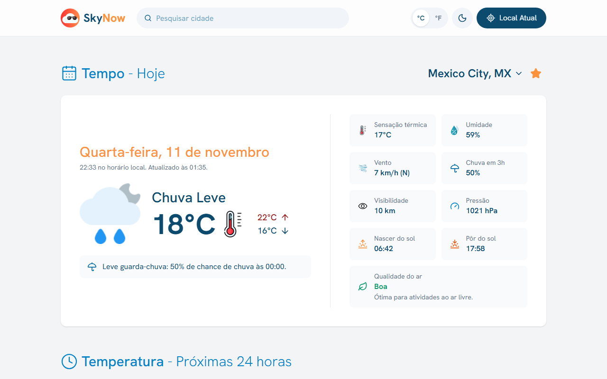
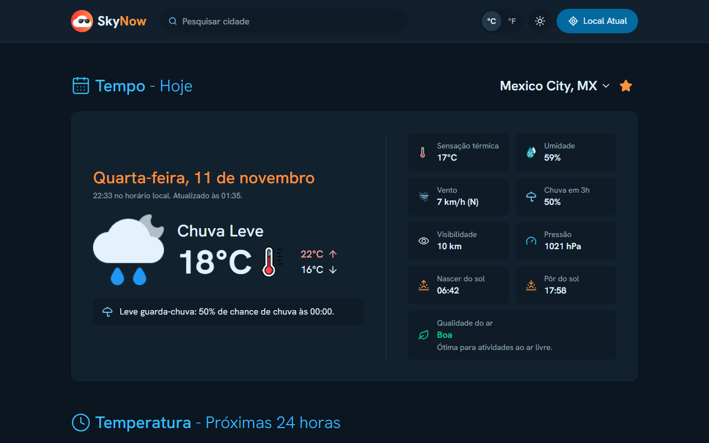
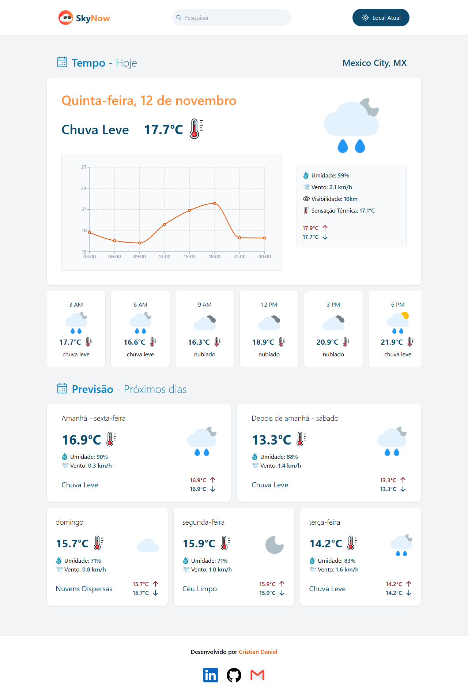
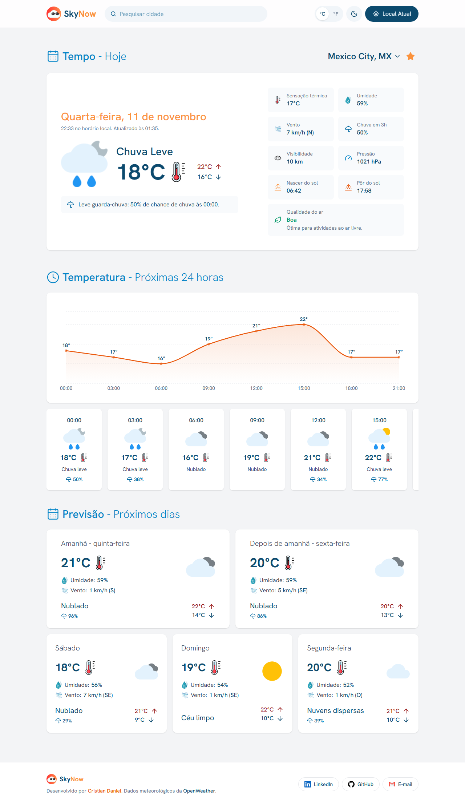
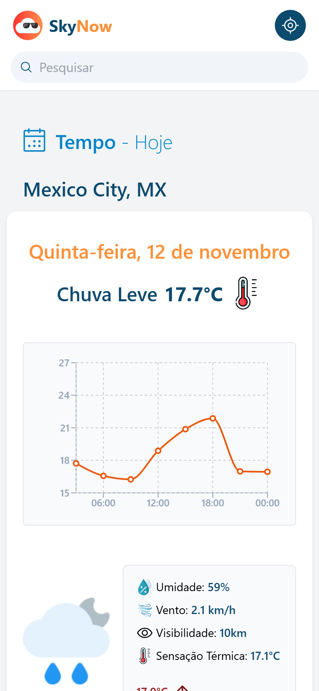
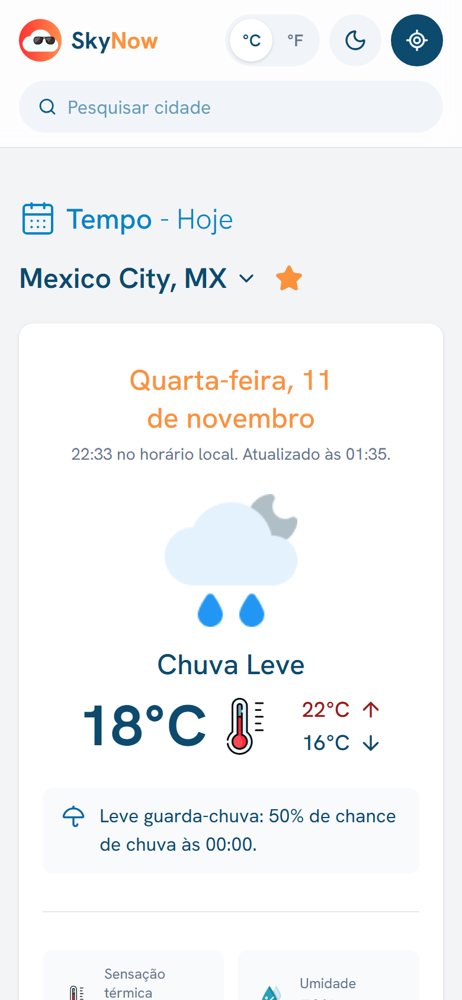
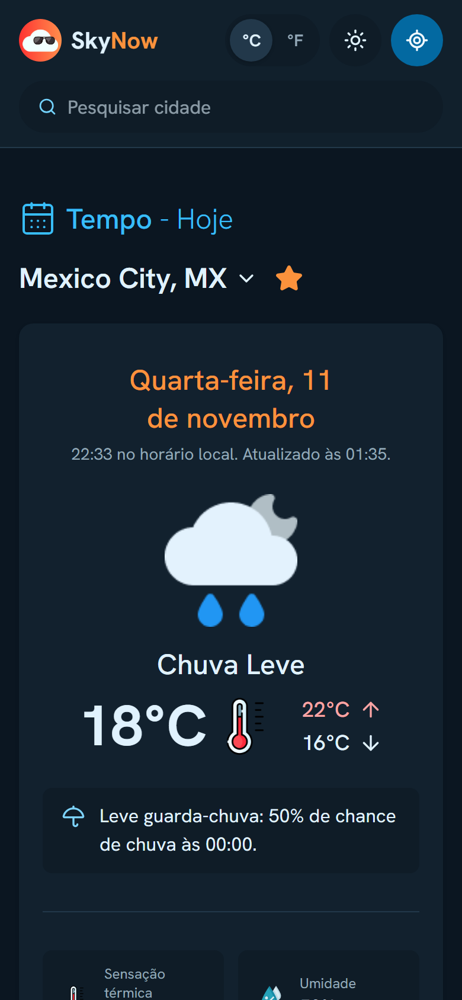

<h1 align="center">
  
  SkyNow v2
</h1>

<p align="center">
  Clima atual, previsão das próximas 24 horas e dos próximos 5 dias para qualquer cidade do mundo.
</p>

<p align="center">
  <a href="https://sky-now.vercel.app/"><strong>Acessar o SkyNow</strong></a>
  ·
  <a href="#-novidades-da-v2">Novidades da v2</a>
  ·
  <a href="#-como-rodar">Como rodar</a>
</p>

<p align="center">
  
  
  
  
  
</p>

<table>
  <tr>
    <td></td>
    <td></td>
  </tr>
  <tr>
    <td align="center">Tema claro</td>
    <td align="center">Tema escuro</td>
  </tr>
</table>

## ✨ Novidades da v2

A v2 é uma reescrita completa da primeira versão do SkyNow. O visual original foi mantido, e o app ganhou novas funcionalidades, um layout mais organizado e passou a funcionar offline.

### Antes e depois

<table>
  <tr>
    <th>v1</th>
    <th>v2</th>
  </tr>
  <tr>
    <td valign="top"></td>
    <td valign="top"></td>
  </tr>
</table>

<table>
  <tr>
    <th>v1 no celular</th>
    <th>v2 no celular (claro)</th>
    <th>v2 no celular (escuro)</th>
  </tr>
  <tr>
    <td valign="top"></td>
    <td valign="top"></td>
    <td valign="top"></td>
  </tr>
</table>

### Novas funcionalidades

- **Tema claro e escuro**, seguindo o sistema ou escolhido pelo usuário.
- **Favoritos:** salve cidades com a estrela e troque entre elas pelo nome da cidade.
- **Buscas recentes** ao clicar no campo de busca vazio.
- **°C ou °F**, com o vento em km/h ou mph e a visibilidade em km ou milhas.
- **Resumo do dia:** uma frase prática, como "Leve guarda-chuva: 70% de chance de chuva às 15:00", "Neve à vista" ou "Dia quente".
- **Qualidade do ar**, com o nível (de "Boa" a "Muito ruim") e uma recomendação.
- **Mais detalhes do dia:** chance de chuva, pressão, nascer e pôr do sol e direção do vento.
- **Localização na primeira visita:** o app oferece mostrar o clima de onde você está, sem pedir permissão ao abrir a página.
- **App instalável (PWA)** no celular e no computador. Ele abre offline com os últimos dados e avisa quando há uma nova versão.

### Visual e experiência

- **Layout mais organizado:** o card de hoje tem a temperatura de um lado e os detalhes em blocos do outro.
- **Gráfico mais limpo:** a temperatura aparece em cada ponto, com uma área em degradê.
- **Header fixo**, com a busca sempre à mão.
- **Rodapé atualizado:** crédito à OpenWeather e links com rótulo.
- **Busca acessível pelo teclado:** setas, Enter e Esc, com o leitor de tela anunciando as sugestões.
- **Estados de carregamento e de erro**, com um botão "Tentar de novo".
- **Responsivo de 360 px até telas grandes**, sem rolagem horizontal.

## 🛠️ Tecnologias

| Área                | Tecnologias                                                                |
| ------------------- | -------------------------------------------------------------------------- |
| Interface           | React 19, TypeScript 6, Tailwind CSS 4, Lucide, Hanken Grotesk             |
| Dados e estado      | TanStack Query 5 (com cache salvo no navegador), Zustand 5, Zod 4          |
| Gráfico             | Recharts 3                                                                 |
| Build e PWA         | Vite 8, vite-plugin-pwa (Workbox)                                          |
| API e deploy        | OpenWeatherMap, função serverless na Vercel                                |
| Qualidade do código | ESLint 10, Prettier, Husky, lint-staged, commitlint (Conventional Commits) |

### APIs da OpenWeatherMap

- **Current Weather:** clima atual.
- **5 Day / 3 Hour Forecast:** previsão das próximas 24 horas e dos próximos dias.
- **Geocoding:** busca de cidades e nome da localização atual.
- **Air Pollution:** qualidade do ar.

## 📁 Estrutura

```
api/
  openweather.ts      # função serverless que chama a OpenWeather com a chave
src/
  app/                # App, providers e configuração do cache
  features/
    layout/           # header e rodapé
    location/         # busca, localização atual, favoritos e recentes
    weather/          # hoje, próximas 24 horas, previsão, resumo e qualidade do ar
    units/            # °C/°F e conversões
    theme/            # tema claro e escuro
    pwa/              # instalação, aviso offline e de nova versão
  shared/             # componentes, hooks e funções usados por várias features
vite-plugins/         # roda a função da API no `npm run dev` e no `npm run preview`
```

Cada feature segue as mesmas pastas (`components`, `hooks`, `lib`, `store`, `constants`, `data`, `interfaces`, `api`) e expõe o que as outras usam pelo seu `index.ts`.

## 🚀 Como rodar

**Pré-requisitos:** Node.js 22 ou mais recente e uma chave gratuita da [OpenWeatherMap](https://home.openweathermap.org/api_keys).

1. Clone o repositório e instale as dependências:

   ```bash
   git clone https://github.com/CristianDaniel1/sky-now.git
   cd sky-now
   npm install
   ```

2. Crie o arquivo `.env.local` a partir do `.env.example` e preencha a sua chave:

   ```bash
   OPENWEATHER_API_KEY=sua_chave
   ```

   A variável não usa o prefixo `VITE_` de propósito: assim ela fica só no servidor e não vai para o navegador.

3. Rode em modo de desenvolvimento e acesse `http://localhost:5173`:

   ```bash
   npm run dev
   ```

### Build de produção

```bash
npm run build
npm run preview
```

O `preview` abre o build em `http://localhost:4173`. Use ele para testar o PWA (instalação, modo offline e aviso de nova versão), porque o service worker não roda no `npm run dev`.

### Scripts

| Comando             | O que faz                                     |
| ------------------- | --------------------------------------------- |
| `npm run dev`       | Servidor de desenvolvimento                   |
| `npm run build`     | Checa os tipos e gera o build em `dist/`      |
| `npm run preview`   | Serve o build localmente, com a função da API |
| `npm run lint`      | ESLint                                        |
| `npm run typecheck` | Checagem de tipos do TypeScript               |
| `npm run format`    | Formata o código com Prettier                 |
| `npm run verify`    | Formatação, lint, tipos e build de uma vez    |

## ☁️ Deploy

O projeto está publicado na Vercel: [sky-now.vercel.app](https://sky-now.vercel.app/).

Para publicar a sua cópia, importe o repositório na Vercel e cadastre a variável de ambiente `OPENWEATHER_API_KEY` em **Settings → Environment Variables**. A Vercel detecta o Vite e publica a função `api/openweather.ts` automaticamente.

## 🗺️ Próximos passos

- Testes automatizados: unitários (Vitest) e de ponta a ponta (Playwright), com checagem de acessibilidade.
- Integração contínua com GitHub Actions.
- Interface em português e inglês.

## 🤝 Contribuição

Contribuições são bem-vindas! Abra uma issue com sugestões ou bugs, ou envie um pull request.

Os commits seguem o padrão [Conventional Commits](https://www.conventionalcommits.org/pt-br/), checado automaticamente pelo commitlint. Antes de enviar, rode `npm run verify`.
